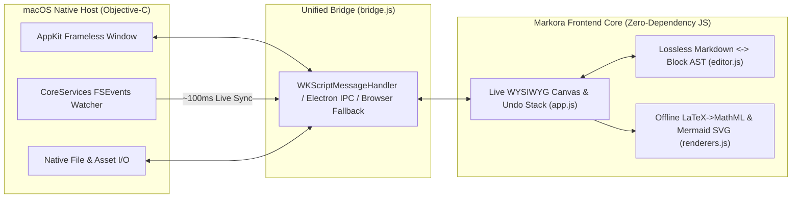

<div align="center">
  

  <h1>Markora</h1>

  <p>
    <strong>极简、轻快、纯粹的 macOS 原生所见即所得（WYSIWYG）Markdown 桌面编辑器</strong><br />
    <sub>Minimalist, Typora-inspired native WYSIWYG Markdown editor for macOS · 252 KB Universal Binary · 100% Offline</sub>
  </p>

  <p>
    <a href="https://github.com/wmingqiang01/Markora/actions/workflows/ci.yml">
      
    </a>
    <a href="https://github.com/wmingqiang01/Markora/releases/latest">
      
    </a>
    
    
    
    <a href="LICENSE">
      
    </a>
  </p>

  <p>
    <a href="#-核心特性">✨ 核心特性</a> ·
    <a href="#-为什么选择-markora">🆚 为什么选择 Markora</a> ·
    <a href="#-下载与安装">📥 下载与安装</a> ·
    <a href="#️-快捷键速查">⌨️ 快捷键速查</a> ·
    <a href="#️-系统架构与目录">🏗️ 系统架构</a> ·
    <a href="#english-overview">🌐 English</a>
  </p>
</div>

<br />

<div align="center">
  
</div>

<br />

**Markora** 是一款致敬 Typora 设计哲学的极简桌面 Markdown 编辑器。它摒弃了传统编辑器割裂的「左写右看」双栏窗口与繁杂工具栏，将**实时排版渲染**与**纯文本无损落盘**融为一体。

底层采用纯正的 macOS 原生 **Cocoa (`AppKit`) + `WKWebView` + `CoreServices (FSEvents)`** 构建，不捆绑 Chromium 或 Node 运行时，**双架构（Apple Silicon + Intel）通用主程序仅 `252 KB`**，毫秒级瞬时冷启动，100% 本地离线运行。

---

## 🆚 为什么选择 Markora？

| 维度 | **Markora (macOS Native)** | 传统 Electron 类编辑器 | 传统双栏 Markdown 编辑器 |
| :--- | :--- | :--- | :--- |
| **核心引擎体积** | **`252 KB` 双架构原生二进制** | 通常 `180 MB ~ 350 MB` | 中等，视框架而定 |
| **冷启动速度** | **`< 80 ms` 瞬时唤醒** | `1.5 s ~ 4.0 s` | 较快 |
| **写作视觉体验** | **单栏实时所见即所得（WYSIWYG）** | 单栏或插件式拼装 | 左右分栏，视线来回跳跃 |
| **公式与图表渲染** | **100% 内置离线 MathML + Mermaid SVG** | 常依赖外部脚本或体积庞大 | 仅在右侧预览窗渲染 |
| **外部修改同步** | **原生 `FSEvents` 毫秒级热更新 + 冲突保护** | 轮询监听或需手动重载 | 视具体工具而定 |
| **隐私与数据主权** | **零联网、零遥测、100% 标准 `.md` 纯文本** | 部分含云端同步或账号体系 | 本地纯文本 |

---

## ✨ 核心特性

### ✍️ 1. 丝滑纯粹的实时所见即所得（Live WYSIWYG）
- **行首即时语法转换**：输入 `# `～`###### `、`- `、`1. `、`- [ ] `、`> `、`> [!NOTE]`、```` ```lang ````、`$$`、`---`，回车或空格瞬间化为精美排版块。
- **焦点段落行内标记感知**：点击任意段落智能展开轻量行内语法标记（`**加粗**`、`*斜体*`、`` `代码` ``、`$公式$`），**精准保持鼠标落点光标偏移**；光标离开即刻恢复纯净阅读态（亦可通过顶部 `¶ 标记` 一键固定开关）。
- **斜杠快捷菜单（`/`）与浮动格式栏**：空行输入 `/` 唤出块级插入面板；选中文字自动浮现加粗、斜体、高亮、行内代码、链接快捷浮层。
- **双模瞬时切换（`Cmd + /`）**：在「所见即所得画布」与带行号的「纯 Markdown 源码模式」之间无缝切换。
- **AST 快照级撤销 / 重做（`Cmd + Z` / `Cmd + Shift + Z`）**：完整覆盖文字输入、段落切分合并、块类型转换、表格增删行列与批量替换。

### 📐 2. 100% 离线科学公式、矢量图表与代码高亮
- **LaTeX 数学公式引擎**：零网络依赖将 LaTeX 编译为浏览器原生高性能 **MathML**，支持行内公式与独立公式块（分式、根式、上下标、大型求和/积分算子、矩阵、分段函数 `cases` 等），点击公式即可原位编辑实时预览。
- **Mermaid 矢量图表引擎**：内置离线 SVG 布局渲染器，原生支持 `flowchart LR/TD` 流程图、`sequenceDiagram` 时序图与 `stateDiagram` 状态图。
- **自适应语法高亮代码块**：内置 JS / TS / Python / Rust / C / C++ / Go / Java / Swift / SQL / Bash / Verilog 等多语言着色器，**删除或新增代码行时高度零延迟自然伸缩**，支持 `ArrowUp` / `ArrowDown` 顺滑跨块进出、代码块末尾一键插入新行与一键复制。

### 📂 3. 原生工作区、实时外部同步与本地图片流
- **macOS `FSEvents` 毫秒级外部同步**：当你在 VS Code、Cursor、终端或通过 `git checkout` 修改文档及目录结构时，Markora 在后台 `~100 ms` 自动无感刷新文件树与正文（自动保持阅读滚动位置）；若外部修改与当前未保存内容冲突，顶部温和弹出**非阻塞冲突保护横幅**，绝不静默丢稿。
- **截图粘贴与拖拽自动归档（`./assets/`）**：直接 `Cmd + V` 粘贴剪贴板截图，或从访达拖入图片文件，自动保存至当前文档同级 `./assets/` 目录并插入相对路径 Markdown 引用，支持 `50%` / `75%` / `100%` 宽度切换与全屏灯箱放大预览。
- **高效侧边栏与全局检索**：
  - **三栏一体**：文件树（`文件`）、滚动联动章节目录（`大纲` Scroll Spy）与最近打开工作区/文档记录（`历史`），支持 `200px ~ 440px` 自由拖拽宽度。
  - **原生级右键菜单**：新建 Markdown、新建子目录、重命名、复制路径、在访达（Finder）中显示、**安全移入 macOS 废纸篓**。
  - **双层极速检索**：`Cmd + P` 全局检索工作区文件名与全文内容直达段落；`Cmd + F` 文内高亮查找与单次/全部替换。

### 🎨 4. 沉浸式阅读主题、原生图标美学与矢量导出
- **跟随系统外观（Auto）+ 4 款精选主题**：内置 `GitHub Light`（清爽亮色）、`Paper Warm`（护眼暖纸）、`Night Dark`（深邃暗夜）、`Nord Minimal`（北欧极简），支持随 macOS 浅色/深色模式自动无缝切换。
- **专注模式（`F8`）与打字机模式（`F9`）**：淡化非当前段落干扰，让正在书写的那一行始终保持在屏幕视觉黄金中心。
- **一键原生导出**：支持导出带完整独立样式的 `.html` 网页，或调用 macOS 原生打印管线导出高清矢量 `.pdf`（`Cmd + Shift + E`）。
- **专属定制双图标**：由 CoreGraphics 纯矢量代码绘制的 macOS 超椭圆应用图标与 `.md` 折角文档关联图标：

<div align="center">
  <table>
    <tr>
      <td align="center" width="220">
        <br />
        <sub><b>AppIcon.icns</b> · 应用主图标</sub>
      </td>
      <td align="center" width="220">
        <br />
        <sub><b>DocumentIcon.icns</b> · Markdown 文档图标</sub>
      </td>
    </tr>
  </table>
</div>

---

## 📥 下载与安装

### 方式一：下载预编译安装包（推荐）

前往 **[GitHub Releases](https://github.com/wmingqiang01/Markora/releases/latest)** 下载最新版的 **`Markora-v1.0.0-macOS-Universal.dmg`**（Apple Silicon `M1/M2/M3/M4` 与 `Intel` 双架构通用）：

1. 双击打开 `.dmg` 镜像，将 **Markora** 拖拽至 **Applications（应用程序）** 文件夹。
2. 在启动台或访达中打开即可（支持在 `.md` 文件上右键 →「打开方式」→ 选择 **Markora**）。

> [!TIP]
> **首次打开安全提示说明**：由于开源社区构建版本采用本地 Ad-hoc 签名（未绑定付费 Apple Developer ID 证书），若首次打开时 macOS 提示「无法验证开发者」或「已损坏」，只需在终端运行以下一行命令移除隔离属性即可正常打开：
> ```zsh
> xattr -cr /Applications/Markora.app
> ```

### 方式二：从源码一键极速编译（仅需 2 秒，零第三方依赖）

无需安装庞大的完整版 Xcode、Node.js 或 Homebrew 依赖，只要有 macOS 系统自带的 `clang`（Command Line Tools）即可在 2 秒内完成图标渲染、双架构编译与签名打包：

```zsh
git clone https://github.com/wmingqiang01/Markora.git
cd Markora

# 一键生成高清图标集并编译 Universal Markora.app
sh build_mac_app.sh

# 直接运行或安装到应用程序目录
cp -R Markora.app /Applications/
open /Applications/Markora.app
```

如果你想在本地打包生成发布级的 `.dmg` 镜像、`.zip` 归档与 `SHA256SUMS.txt` 校验文件：

```zsh
sh scripts/package_release.sh v1.0.0
```

### 方式三：跨平台 Electron / 纯 Web 浏览器模式（可选）

除了原生 macOS 宿主外，仓库同样保留了完整的跨平台桥接兼容层：

```zsh
# 可选 1：通过 Electron 启动桌面端（需安装 Node.js）
npm install && npm start

# 可选 2：在任意现代浏览器中直接预览体验
python3 -m http.server 8080 --directory src
```

---

## ⌨️ 快捷键速查

| 类别 | 功能操作 | 快捷键 / 触发方式 | 说明 |
| :--- | :--- | :--- | :--- |
| **文件与工作区** | 新建 / 打开 / 保存 / 另存为 | `Cmd + N` / `O` / `S` / `Shift + S` | 原生本地文件读写 |
| | 导出高清矢量 PDF | `Cmd + Shift + E` | 支持分页保护与主题保留 |
| | 重新从磁盘同步 | `Cmd + R` | 强制重新扫描工作区与当前文档 |
| | 显示 / 隐藏侧边栏 | `Cmd + Shift + L` | 沉浸全屏书写 |
| **导航与搜索** | **快速跳转 / 全文搜索** | `Cmd + P` | 毫秒级检索工作区文件名与正文 |
| | **文内查找与替换** | `Cmd + F` | 高亮定位匹配词，支持单次/全部替换 |
| **视图与专注** | **切换所见即所得 / 源码模式** | `Cmd + /` | 双向无损即时切换 |
| | **专注模式 / 打字机模式** | `F8` / `F9` | 淡化非焦点段落 / 光标保持垂直居中 |
| **块级与行内排版** | 一级至六级标题 / 恢复正文 | `Cmd + 1~6` / `Cmd + 0` | 或在行首直接输入 `# `～`###### ` |
| | 快捷插入任意块 | 空行输入 `/` | 唤出表格、代码块、公式、图表菜单 |
| | 加粗 / 斜体 / 行内代码 / 链接 | `Cmd + B` / `I` / `E` / `K` | 选中文本亦会自动弹出浮动工具条 |
| | 粘贴截图并归档本地 | `Cmd + V` | 自动存入同级 `./assets/` 目录 |
| | 跨出代码块 / 公式块到新行 | `Cmd + Enter` 或 `↓` | 顺滑退出复杂块并继续正文写作 |
| | 全局撤销 / 重做 | `Cmd + Z` / `Cmd + Shift + Z` | 文档级 AST 快照历史栈 |

---

## 🏗️ 系统架构与目录



```text
Markora/
├── macos/
│   ├── main.m                 # macOS 原生宿主（无边框沉浸窗口、WKWebView 桥接、FSEvents 实时监听）
│   ├── generate_icon.m        # CoreGraphics 纯矢量绘制应用主图标生成器（AppIcon.icns）
│   └── generate_doc_icon.m    # CoreGraphics 专属 .md 文档折角图标生成器（DocumentIcon.icns）
├── src/
│   ├── index.html             # 编辑器主界面骨架与模态面板
│   ├── styles/main.css        # 排版引擎与 4 套精选主题样式表
│   └── js/
│       ├── editor.js          # Markdown <-> Block AST 双向无损解析与序列化核心
│       ├── renderers.js       # 离线多语言高亮、LaTeX->MathML 编译器与 Mermaid 矢量引擎
│       ├── bridge.js          # 自适应三端桥接层（macOS Native / Electron / Web Fallback）
│       ├── icons.js           # 像素级对齐 SVG 图标库
│       └── app.js             # WYSIWYG 交互状态机、AST 撤销栈、全文搜索与文件树管理
├── electron/                  # 可选的跨平台 Electron 宿主与安全 Preload 桥接
├── workspace/                 # 开箱即用的示例 Markdown 知识库文档
├── tests/test_suite.js        # 基于 macOS JavaScriptCore (jsc) 的自动化回归测试套件
├── build_mac_app.sh           # 一键生成图标并编译签名 Universal Markora.app
├── scripts/package_release.sh # 自动化构建 .dmg / .zip 安装包与 SHA-256 校验清单
└── .github/workflows/         # GitHub Actions 自动化 CI 测试与 Tag Release 发版流水线
```

### 🧪 运行自动化测试

项目内置基于系统原生 `JavaScriptCore` 的无头自动化回归测试套件，覆盖路径编码、双向无损 Markdown 序列化、末尾新行保障及外部文件同步逻辑：

```zsh
/System/Library/Frameworks/JavaScriptCore.framework/Versions/Current/Helpers/jsc tests/test_suite.js
```

---

<a id="english-overview"></a>
<details>
<summary><b>🌐 English Overview (Click to expand)</b></summary>

<br />

**Markora** is a minimalist, Typora-inspired WYSIWYG Markdown desktop editor built natively for macOS using **Cocoa (`AppKit`) + `WKWebView` + `CoreServices (FSEvents)`**.

### Key Highlights
- **⚡ Featherweight & Instant**: Universal binary (`arm64` + `x86_64`) weighs just **252 KB** with sub-80ms cold start and zero runtime dependencies.
- **True Single-Pane WYSIWYG**: Live block conversion, smart inline marker expansion on active paragraphs with exact cursor-offset preservation, slash `/` command menu, floating selection toolbar, and instant Source Code toggle (`Cmd + /`).
- **100% Offline Scientific & Diagram Rendering**: Built-in zero-dependency **LaTeX-to-MathML** engine and **Mermaid SVG** diagram renderer (`flowchart`, `sequenceDiagram`, `stateDiagram`), plus multi-language syntax-highlighted code blocks.
- **Native Workspace & Live External Sync**: Real-time `FSEvents` file/folder watcher (`~100ms` latency) with non-blocking conflict protection, clipboard/drag-and-drop image archiving to `./assets/`, Scroll-Spy TOC outline, `Cmd + P` Quick Open, and `Cmd + F` Find & Replace.
- **Themes & Native Export**: Auto dark/light system sync + 4 curated themes (`GitHub Light`, `Paper Warm`, `Night Dark`, `Nord Minimal`), Focus Mode (`F8`), Typewriter Mode (`F9`), and standalone HTML / vector PDF export.

### Quick Build on macOS
```zsh
git clone https://github.com/wmingqiang01/Markora.git
cd Markora
sh build_mac_app.sh
open Markora.app
```

</details>

---

## 🤝 贡献与反馈

欢迎提交 [Issue](https://github.com/wmingqiang01/Markora/issues) 反馈问题或想法，也欢迎直接发起 [Pull Request](https://github.com/wmingqiang01/Markora/pulls) 一起打磨更纯粹的写作体验！如果这个项目对你有帮助，欢迎点亮右上角的 **⭐️ Star** 支持。

## 📄 开源协议

本项目基于 [MIT License](LICENSE) 协议开源，Copyright © 2026 [wmingqiang01](https://github.com/wmingqiang01)。
