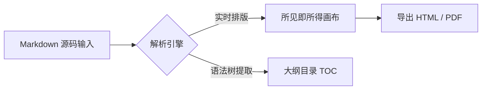

# 欢迎使用 Markora — 极简所见即所得 Markdown 编辑器

> [!NOTE]
> **Markora** 是一款致敬 Typora 的轻量级原生桌面 Markdown 编辑器。它将「书写」与「预览」融为一体，让你专注于内容本身。

## ✨ 核心特性一览

在 **Markora** 中，你无需忍受左右分屏的割裂感。当你输入 Markdown 语法时，文档会实时呈现排版效果；而当你将光标移入某一段落（或按下 `Cmd + /` 切换源码模式）时，又能精准掌控每一处标记。

- **实时所见即所得**：标题、列表、引用、表格、任务列表实时渲染，行内焦点智能展开语法标记。
- **双击/快捷键切换源码**：随时按 `Cmd + /` 在「所见即所得视图」与「纯 Markdown 源码视图」之间无缝切换。
- **大纲与本地文件树**：左侧边栏支持本地文件夹目录树管理与文档结构大纲（TOC）联动跳转。
- **专注模式与打字机模式**：支持段落聚焦（Focus Mode）与光标居中（Typewriter Mode），沉浸式创作。
- **科学绘图与公式支持**：内置离线 **LaTeX 数学公式（MathML 原生排版）**、**Mermaid 流程图/时序图** 与 **多语言代码高亮**。

---

## ⌨️ 常用快捷键与行首触发语法

| 功能操作 | 快捷键 / 触发方式 | 说明 |
| :--- | :--- | :--- |
| **切换源码模式** | `Cmd + /` | 在所见即所得与 Markdown 源码间切换 |
| **一级至六级标题** | `Cmd + 1~6` 或输入 `# ` | 行首输入 `#` 加空格立即转为标题 |
| **加粗 / 斜体 / 行内代码** | `Cmd + B` / `Cmd + I` / `Cmd + E` | 支持选中文字后通过悬浮工具栏设置 |
| **专注模式 / 打字机模式** | `F8` / `F9` | 仅高亮当前正在编辑的段落 |
| **快捷插入菜单** | 行首输入 `/` | 呼出块级元素快捷插入面板 |
| **快速跳转 / 全文搜索** | `Cmd + P` | 检索工作区文件名与全文内容 |
| **文内查找与替换** | `Cmd + F` | 高亮定位当前文档匹配项并支持批量替换 |
| **粘贴 / 拖拽本地图片** | `Cmd + V` 或拖入图片 | 自动拷贝至 `./assets/` 目录并支持缩放与灯箱预览 |
| **撤销 / 重做** | `Cmd + Z` / `Cmd + Shift + Z` | 全局 AST 快照级无损撤销与重做 |
| **保存文档 / 导出 PDF** | `Cmd + S` / `Cmd + Shift + E` | 直接读写本地磁盘文件或导出矢量 PDF |

---

## ✅ 交互式任务列表

你可以直接点击下方的复选框来切换完成状态，修改会同步更新底层 Markdown 源码：

- [x] 设计极简无干扰的沉浸式排版界面
- [x] 实现实时所见即所得（WYSIWYG）与源码模式无缝切换
- [x] 集成 LaTeX 数学公式渲染与实时编辑面板
- [x] 集成 Mermaid 流程图与时序图矢量渲染
- [ ] 点击左侧文件树探索更多示例文档，或打开你自己的本地文件夹！

---

## 🧮 数学公式（LaTeX）

Markora 支持行内公式（如质能方程 $E = mc^2$、欧拉恒等式 $e^{i\pi} + 1 = 0$）以及独立公式块。点击下方公式块即可直接编辑 LaTeX 源码：

$$
f(x) = \frac{1}{\sigma\sqrt{2\pi}} \exp\left( -\frac{(x - \mu)^2}{2\sigma^2} \right)
$$

$$
\int_{-\infty}^{+\infty} e^{-x^2} dx = \sqrt{\pi} \quad , \quad \sum_{n=1}^{\infty} \frac{1}{n^2} = \frac{\pi^2}{6}
$$

---

## 📊 Mermaid 流程图与架构图

点击图表可展开源码编辑器并实时预览修改效果：



---

## 💻 代码块与语法高亮

支持主流编程语言语法高亮、行号显示、语言切换与一键复制：

```javascript
// Markora 响应式文档状态管理示例
class DocumentSession {
  constructor(filePath, content = '') {
    this.filePath = filePath;
    this.content = content;
    this.isDirty = false;
  }

  update(nextMarkdown) {
    if (nextMarkdown !== this.content) {
      this.content = nextMarkdown;
      this.isDirty = true;
      return true;
    }
    return false;
  }
}
```
