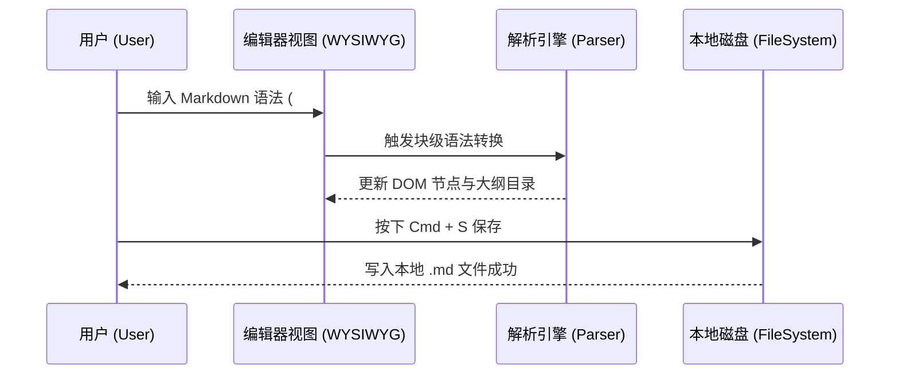

# 数学公式与科学绘图指南

本文档展示了 **Markora** 内置的数学公式排版引擎与 Mermaid 图表渲染能力。

## 1. 微积分与级数展开

泰勒级数（Taylor Series）将光滑函数表示为无穷幂级数之恶的钛合金你的风格和你好地方和：

$$
f(x) = \sum_{n=0}^{\infty} \frac{f^{(n)}(a)}{n!} (x - a)^n
$$

麦克斯韦方程组（微分形式）描述了电磁场的基本规律：

$$
\nabla \cdot \mathbf{E} = \frac{\rho}{\varepsilon_0} \quad , \quad \nabla \times \mathbf{B} = \mu_0 \mathbf{J} + \mu_0 \varepsilon_0 \frac{\partial \mathbf{E}}{\partial t}
$$

## 2. 线性代数与矩阵

支持 `\begin{pmatrix}`、`\begin{bmatrix}` 等矩阵环境：

$$
A = \begin{pmatrix} a_{11} & a_{12} & a_{13} \\ a_{21} & a_{22} & a_{23} \\ a_{31} & a_{32} & a_{33} \end{pmatrix} , \quad \det(A - \lambda I) = 0
$$

## 3. Mermaid 时序图（Sequence Diagram）



## 4. 算法实现示例（Python）

```python
def quicksort(arr: list[int]) -> list[int]:
    """快速排序递归实现"""
    if len(arr) <= 1:
        return arr
    pivot = arr[len(arr) // 2]
    left = [x for x in arr if x < pivot]
    middle = [x for x in arr if x == pivot]
    right = [x for x in arr if x > pivot]
    return quicksort(left) + middle + quicksort(right)

if __name__ == "__main__":
    sample = [38, 27, 43, 3, 9, 82, 10]
    print("Sorted:", quicksort(sample))
```
